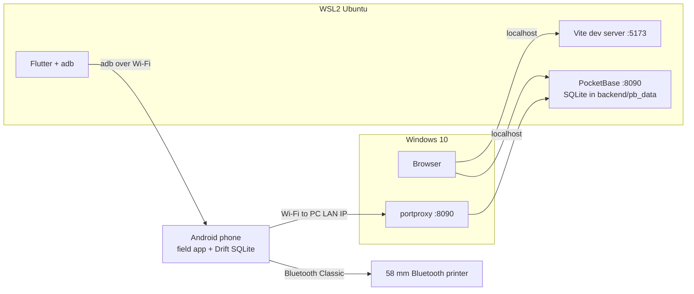

# Local development setup

How to install everything Watney needs on a developer machine, and how to start it. In the current phase everything runs locally (see [tech-spec](tech-spec.md) §12). Hosting on Fly.io comes in a later phase.

_Checked on 2026-10-16 on the main dev machine: Windows 10 22H2 (build 19045), WSL2 with Ubuntu 26.04, zsh. "Latest" versions below are the newest releases on that date._

Related docs: [README](../README.md) (component layout and `make` targets), [backend/README](../backend/README.md), [web/README](../web/README.md), [mobile/README](../mobile/README.md). Two agent skills build on this doc:

- `/setup-local-development` checks your machine against it and walks you through anything missing or out of date.
- `/start-local-development` starts only what your task needs (§5).

Each component (`backend/`, `web/`, `mobile/`) is self-contained, so install only what the components you work on need. The **Needed for** column in §2 says which tools each component uses.

## 1. What runs, and where

| Component | Technology | Runs on | Address |
|---|---|---|---|
| Backend: API, auth, file storage, hooks | PocketBase 0.40.5 (pinned) | WSL | http://localhost:8090 (dashboard at `/_/`) |
| Server database | SQLite, built into PocketBase | WSL, files in `backend/pb_data/` | — |
| Web admin | React 18 + Vite 5 dev server | WSL, opened in a Windows browser | http://localhost:5173 |
| Field app | Flutter, Android | Android phone (emulator optional, see §6.3) | — |
| Phone database: offline cache and outbox | SQLite through Drift, inside the app | phone | — |
| Receipt printer | 58 mm Bluetooth Classic thermal printer | paired with the phone | — |



### Not needed

- **Docker.** PocketBase is a single binary, and the web and mobile tools run directly. Docker isn't installed on the dev machine, and nothing here needs it. The later Fly.io phase adds a Dockerfile, but `fly deploy` can build it on Fly's remote builder, so local Docker stays optional even then.
- **A database server** (Postgres, MySQL, and so on). The server's SQLite database is inside PocketBase, and the phone's SQLite database is inside the app.
- **Go.** We use the prebuilt PocketBase binary with JavaScript hooks. Go is only needed to extend PocketBase as a Go framework, and we don't do that.
- **Android Studio.** Optional. The command-line Android SDK is enough. Android Studio on Windows is only useful for the emulator.
- **Chrome and the Linux desktop toolchain** (clang, CMake, ninja). `flutter doctor` reports them as missing. Ignore that: Watney only targets Android.

## 2. System tools

| Tool | Version | Used for | Needed for |
|---|---|---|---|
| Git | any recent | source control | all |
| GitHub CLI (`gh`) | 2.x | issues and PRs ([issue tracker](agents/issue-tracker.md)) | all |
| make | GNU Make 4 | `make <component>`, `-setup`, `-check` | all |
| curl, unzip, sha256sum | any | download and verify PocketBase | backend |
| PocketBase | 0.40.5, pinned in `backend/.pocketbase-version` | backend and server database | backend (web and mobile need it running) |
| Node.js | 20 or newer (LTS) | web admin tooling | web |
| pnpm | 11 | web package manager | web |
| Flutter SDK (includes Dart) | stable; match `flutter-version` in `.github/workflows/ci.yml` so format and analyze agree with CI (needs Dart 3.13+) | field app | mobile |
| JDK | 21 (17+ required) | Android Gradle builds | mobile |
| Android SDK: cmdline-tools, platform-tools (`adb`), platform 36, NDK 28.2.13676358 | — | build and install the APK | mobile |
| Android phone | Android 11+ for Wi-Fi debugging (the app itself needs Android 7.0, API 24) | run the field app | mobile |
| 58 mm Bluetooth Classic thermal printer | — | receipt printing (#11) | mobile, from #11 |

The field app's `pubspec.yaml` requires Dart `^3.13.0`, so you need a Flutter release that ships Dart 3.13 or newer. When this table and a project file disagree (`backend/.pocketbase-version`, `mobile/pubspec.yaml`, `web/package.json`), the project file is right and this table needs updating.

### 2.1 Base packages

```bash
sudo apt update
sudo apt install -y git make curl unzip zip xz-utils libglu1-mesa
```

- `git` and `make` are used every day.
- `curl` and `unzip` are used by `backend/scripts/install-pocketbase.sh`.
- `zip`, `xz-utils` and `libglu1-mesa` are prerequisites of the Flutter SDK on Linux.

On the dev machine, curl and unzip come from Homebrew (linuxbrew). Either source works.

### 2.2 GitHub CLI

Install it with the apt repository described in [the gh Linux install guide](https://github.com/cli/cli/blob/trunk/docs/install_linux.md), then log in:

```bash
gh auth login
```

Usage: `gh issue list`, and `gh issue view 2 --comments` to read an issue. Always read the comments, because agent-brief comments override some issue bodies.

### 2.3 Node.js and pnpm

Install nvm by following [its README](https://github.com/nvm-sh/nvm#installing-and-updating), then:

```bash
nvm install --lts
npm install -g pnpm@11
```

Usage: `pnpm install` installs the web dependencies, `pnpm dev` starts the admin, and `pnpm add <package>` adds a library. pnpm 11 blocks dependencies' install scripts unless `web/pnpm-workspace.yaml` allows them (esbuild is already allowed).

### 2.4 Flutter SDK

```bash
mkdir -p ~/development
git clone -b stable https://github.com/flutter/flutter.git ~/development/flutter
echo 'export PATH="$HOME/development/flutter/bin:$PATH"' >> ~/.zshrc
source ~/.zshrc
flutter --version
```

Optional: hide the Chrome and Linux-desktop warnings. This is a global Flutter setting, so it affects your other Flutter projects too.

```bash
flutter config --no-enable-web --no-enable-linux-desktop
```

Usage: `flutter pub get`, `flutter run`, `flutter test`, `flutter analyze`, `dart format`, and `flutter doctor` to check the setup.

### 2.5 JDK 21

```bash
sudo apt install -y openjdk-21-jdk
flutter config --jdk-dir=/usr/lib/jvm/java-21-openjdk-amd64
```

The Android build (Gradle 9.3.1 with Android Gradle Plugin 9.1.0) needs JDK 17 or newer. JDK 21 is the long-term-support release that Android Studio ships. Java 25, the system default on the dev machine, is newer than Android tooling is usually tested with. `--jdk-dir` makes Flutter use JDK 21 without changing the system `java`.

Usage: you don't run it directly. Gradle uses it during `flutter run` and `flutter build apk`.

### 2.6 Android SDK (command line, inside WSL)

The dev machine already has an Android SDK on Windows (`C:\Users\<you>\AppData\Local\Android\Sdk`), but WSL can't use it, because its tools are Windows `.exe` files. Install a Linux SDK:

1. Download **Command line tools only** for Linux from <https://developer.android.com/studio#command-line-tools-only>. The file is named `commandlinetools-linux-<build>_latest.zip`. From WSL, the Windows Downloads folder is `/mnt/c/Users/<you>/Downloads`.
2. Unpack it into the layout `sdkmanager` expects:
   ```bash
   mkdir -p ~/Android/Sdk/cmdline-tools
   unzip /mnt/c/Users/<you>/Downloads/commandlinetools-linux-*_latest.zip -d ~/Android/Sdk/cmdline-tools
   mv ~/Android/Sdk/cmdline-tools/cmdline-tools ~/Android/Sdk/cmdline-tools/latest
   ```
3. Add this to `~/.zshrc`, then run `source ~/.zshrc`:
   ```bash
   export ANDROID_HOME="$HOME/Android/Sdk"
   export PATH="$ANDROID_HOME/cmdline-tools/latest/bin:$ANDROID_HOME/platform-tools:$PATH"
   ```
4. Install the SDK packages, accept the licences, and check:
   ```bash
   sdkmanager "platform-tools" "platforms;android-36" "ndk;28.2.13676358"
   flutter config --android-sdk "$HOME/Android/Sdk"
   flutter doctor --android-licenses
   flutter doctor
   ```

API 36 and NDK 28.2.13676358 are Flutter 3.47's defaults (`flutter.compileSdkVersion` and `flutter.ndkVersion`). Gradle downloads any other parts it needs, such as build-tools, on the first build.

Usage: `adb devices`, `adb pair` and `adb connect` (§6.1); `sdkmanager --list_installed` shows what's installed.

### 2.7 PocketBase

You don't install it by hand. `make backend-setup` (or `make backend`) runs `backend/scripts/install-pocketbase.sh`. The script downloads the version named in `backend/.pocketbase-version` into `backend/bin/` and checks its SHA-256 checksum. For the upgrade policy and folder layout, see [backend/README](../backend/README.md).

Usage: `make backend` starts it. The dashboard is at http://localhost:8090/_/, and `backend/bin/pocketbase superuser upsert …` creates a dashboard account (§4).

### 2.8 Optional tools

- **sqlite3 CLI** (`sudo apt install -y sqlite3`): read-only peeks at `backend/pb_data/data.db`. Always write through PocketBase (the API or the dashboard), never straight to the file. Direct writes skip the hooks, the access rules and the audit log.
- **VS Code** with the WSL, Flutter, Dart and ESLint extensions.

## 3. Project libraries

`make web-setup` and `make mobile-setup` install everything already listed in `web/package.json` and `mobile/pubspec.yaml` (they run `pnpm install` and `flutter pub get`). Each table shows what the scaffold has now, then the libraries planned in tech-spec §3 and §5. Whoever implements the issue that first needs a planned library runs its install command, which records it in the manifest for everyone else.

On 2026-10-16, all the planned libraries were checked against the scaffold: they resolve together, with no peer-dependency conflicts.

### 3.1 Web admin (`web/`)

Already in the scaffold:

| Package | Usage |
|---|---|
| `react`, `react-dom` 18.3 | UI library |
| `vite` 5 + `@vitejs/plugin-react` | dev server with hot reload; production build |
| `typescript` 5.6 | type checking (`pnpm build` runs `tsc -b` first) |
| `eslint` 9 + `typescript-eslint`, `eslint-plugin-react-hooks`, `eslint-plugin-react-refresh`, `globals` | `pnpm lint` |
| `vitest` 2 + `jsdom` 25 | `pnpm test`; jsdom gives tests a browser-like DOM |
| `@testing-library/react` + `@testing-library/dom` | render components in tests and find elements the way a user would |

Planned. Run these from `web/`:

| Library | Usage | Install |
|---|---|---|
| `pocketbase` (JS SDK) | login, records, files and realtime against the backend | `pnpm add pocketbase@^0.28.1` |
| `@tanstack/react-query` | fetch and cache server data; refetch after changes | `pnpm add @tanstack/react-query@5` |
| `react-router-dom` | pages and URLs (login, home, lists) | `pnpm add react-router-dom@6` |
| `tailwindcss` + `postcss` + `autoprefixer` | utility-class styling | `pnpm add -D tailwindcss@3 postcss autoprefixer` then `pnpm exec tailwindcss init -p` |
| shadcn/ui (Radix) | ready-made accessible components, copied into `src/components/ui` | `pnpm dlx shadcn@2.3.0 init`. 2.3.0 is the last CLI release for Tailwind 3. It needs Tailwind and the `@/*` path alias set up first. |
| `react-hook-form` + `zod` + `@hookform/resolvers` | forms and validation (staff, customers, tariffs) | `pnpm add react-hook-form@7 zod@3 @hookform/resolvers` |
| `recharts` | charts for the Phase 2+ dashboards | `pnpm add recharts@2` |
| `vite-plugin-pwa` | installable app with an offline shell | `pnpm add -D vite-plugin-pwa@0.20` |
| `@testing-library/user-event` (optional) | realistic typing and clicking in tests | `pnpm add -D @testing-library/user-event` |
| `@playwright/test` (optional) | end-to-end tests in a real browser | `pnpm add -D @playwright/test` then `pnpm exec playwright install --with-deps chromium` |

### 3.2 Field app (`mobile/`)

Already in the scaffold:

| Package | Usage |
|---|---|
| `flutter` (SDK) | UI framework |
| `cupertino_icons` | iOS-style icons (template default; can be removed) |
| `flutter_test` (SDK) | unit and widget tests (`flutter test`) |
| `flutter_lints` | lint rules for `flutter analyze` |
| `pocketbase` | backend client: auth, records, photo upload |
| `flutter_secure_storage` | keep the login session in encrypted storage |
| `http` (dev) | `MockClient`, a fake backend for testing the PocketBase code |

Planned. Run these from `mobile/`:

| Package | Usage | Install | Android setup |
|---|---|---|---|
| `flutter_riverpod` | state management | `flutter pub add flutter_riverpod` | — |
| `drift` + `drift_flutter` | local SQLite: the route cache and the outbox for offline sync | `flutter pub add drift drift_flutter` | — |
| `drift_dev` + `build_runner` | generate Drift's typed database code | `flutter pub add dev:drift_dev dev:build_runner`; regenerate with `dart run build_runner build` | — |
| `go_router` | screens and navigation | `flutter pub add go_router` | — |
| `image_picker` + `image` | take the meter-dial photo with the camera; resize and compress it | `flutter pub add image_picker image` | — |
| `geolocator` | GPS position saved with each reading | `flutter pub add geolocator` | location permissions in `AndroidManifest.xml` |
| `connectivity_plus` | detect online/offline to start a sync | `flutter pub add connectivity_plus` | — |
| `esc_pos_utils_plus` | build the ESC/POS receipt bytes (text, image, QR) | `flutter pub add esc_pos_utils_plus` | — |
| `print_bluetooth_thermal` | send those bytes to the printer over Bluetooth Classic | `flutter pub add print_bluetooth_thermal` | Bluetooth permissions in `AndroidManifest.xml` (see the package README) |
| `qr_flutter` | show the PromptPay QR on screen | `flutter pub add qr_flutter` | — |
| `mocktail` | fakes and mocks in unit tests | `flutter pub add dev:mocktail` | — |
| `integration_test` (SDK) | end-to-end tests on a device | `flutter pub add 'dev:integration_test:{"sdk":"flutter"}'` | — |

### 3.3 Version notes

Some versions in the tech spec are out of date.

**Field app.** The commands above install the latest releases, because old plugin versions often fail to build with the current Android Gradle Plugin (9.1). Tech-spec §3 should be updated to match:

| Package | Tech spec | Latest (2026-10-16) |
|---|---|---|
| `flutter_riverpod` | ^2.x | 3.4.3 |
| `go_router` | ^14.x | 18.1.0 |
| `geolocator` | ^13.x | 14.1.1 |
| `connectivity_plus` | ^6.x | 7.3.2 |
| `flutter_secure_storage` | ^9.x | 11.2.0 |
| `sqlite3_flutter_libs` | with Drift | **Discontinued.** Its page says to use `sqlite3` 3.x instead. Drift 2.35 already uses `sqlite3` 3.x, so add `drift_flutter` instead. |
| `blue_thermal_printer` | alternative printer plugin | No release since 2022. Use `print_bluetooth_thermal` (1.2.5, September 2026). |
| `esc_pos_utils_plus` | ^2.x | 2.0.4. Its last release was September 2024, so keep an eye on it. |

**Web admin.** The commands keep the tech spec's major versions, because the scaffold is built on React 18, Vite 5 and Vitest 2. Newer majors exist (`react-router-dom` 7, `zod` 4, `recharts` 3, `vite-plugin-pwa` 2, Tailwind 4). Moving to them is a separate decision.

**PocketBase SDKs.** JS SDK 0.28.x and Dart SDK 0.25.x are the releases that added PocketBase 0.40's endpoints. When you change `backend/.pocketbase-version`, update both SDKs in the same change.

### 3.4 Backend (`backend/`)

Nothing to install. Hooks (`backend/pb_hooks/*.pb.js`) and migrations (`backend/pb_migrations/*.js`) are plain JavaScript run by PocketBase's built-in engine, so Node and npm packages aren't involved. On start, PocketBase writes `backend/pb_data/types.d.ts`. For editor autocomplete in a hook file, add `/// <reference path="../pb_data/types.d.ts" />` as its first line.

## 4. First-time setup

```bash
git clone git@github.com:teethat-lsk/watney.git
cd watney
make backend-setup   # PocketBase binary
make web-setup       # web packages (if you work on web)
make mobile-setup    # Flutter packages (if you work on mobile)
flutter doctor       # mobile only: expect ✓ for Flutter and the Android toolchain; ✗ for Chrome or the Linux toolchain is fine
make backend         # on first start, open the printed link to create the first superuser
```

You can also create the superuser from the command line:

```bash
backend/bin/pocketbase superuser upsert you@example.com 'a-strong-password' --dir backend/pb_data
```

A superuser is an operator account for the PocketBase dashboard, not an app login (tech-spec §8). To log in to the web admin, create the first admin staff user. It reads its email and password from a git-ignored `backend/.env`:

```bash
cp backend/.env.example backend/.env   # then change the email and password
make backend-seed                      # run it again later to change the password
```

Then run `make backend` and `make web`, open http://localhost:5173, and log in with those credentials.

## 5. Daily startup

Start only what your task needs, each component in its own terminal. Admin pages and field-app screens that call the API need the backend running. Pure Dart logic, such as billing, needs only `flutter test`: no backend, no phone and no Android build. To have an agent see what's already running, start what your task needs, and suggest what to stop to free memory, run `/start-local-development`.

```bash
make backend           # PocketBase on :8090
make web               # admin on :5173
make mobile            # field app on the connected phone (§6)
make <component>-check # before pushing: that component's lint, analyze and tests
```

Inside a component folder, the same commands are `make dev` and `make check`. `make backend-check` boots a throwaway PocketBase on `127.0.0.1:8091` (set `PB_CHECK_PORT` to change it), so it can run while `make backend` is up.

To keep memory down, open only the component's folder in your editor (README, "Working on one component"). Android builds are the heaviest part: `mobile/android/gradle.properties` caps the Gradle heap and stops an idle Gradle daemon after 15 minutes.

| What | Address |
|---|---|
| Web admin | http://localhost:5173 |
| PocketBase dashboard | http://localhost:8090/_/ |
| API health check | http://localhost:8090/api/health |

How each part reloads:

- **Admin:** Vite reloads the page when you save a file.
- **Field app:** in the `flutter run` terminal, press `r` for hot reload or `R` for hot restart.
- **Hooks:** PocketBase restarts by itself when files in `pb_hooks/` change.
- **Migrations:** applied when PocketBase starts, so restart `make backend` after pulling new ones.

## 6. Running the field app on a device

### 6.1 Real phone over Wi-Fi (recommended)

You'll need a real phone sooner or later anyway, for the camera (meter-dial photo) and the Bluetooth printer.

1. On the phone, open **Settings → About phone** and tap **Build number** seven times to enable **Developer options**. Then turn on **Developer options → Wireless debugging** (Android 11+). The phone and the PC must be on the same Wi-Fi.
2. Tap **Wireless debugging → Pair device with pairing code**, then run this in WSL:
   ```bash
   adb pair <phone-ip>:<pairing-port>   # enter the 6-digit code
   adb connect <phone-ip>:<port>        # the port shown on the Wireless debugging screen
   flutter devices
   ```
3. Run `make mobile`.

WSL can't see USB devices without extra software ([usbipd-win](https://github.com/dorssel/usbipd-win)), so Wi-Fi debugging is the simpler route.

### 6.2 Let the phone reach the backend

[backend/README](../backend/README.md#reaching-the-backend-from-a-phone) lists the addresses and both WSL options. **The dev machine runs Windows 10, so mirrored networking isn't available** (it needs Windows 11 22H2+). Use the port proxy instead.

WSL gets a new IP address every time it restarts, so run this in an **admin PowerShell** after each restart:

```powershell
$wslIp = (wsl.exe hostname -I).Trim().Split(' ')[0]
netsh interface portproxy delete v4tov4 listenport=8090 listenaddress=0.0.0.0
netsh interface portproxy add v4tov4 listenport=8090 listenaddress=0.0.0.0 connectport=8090 connectaddress=$wslIp
```

Open the firewall once. This rule applies only on networks Windows marks as **Private**, so set your Wi-Fi to Private in Windows settings:

```powershell
New-NetFirewallRule -DisplayName "Watney PocketBase" -Direction Inbound -Protocol TCP -LocalPort 8090 -Action Allow -Profile Private
```

Find the PC's LAN IP with `ipconfig` on Windows (**Wireless LAN adapter Wi-Fi → IPv4 Address**). To test, open `http://<pc-ip>:8090/api/health` in the phone's browser.

Then start the app with that address built in: `make mobile PB_URL=http://<pc-ip>:8090` (see [mobile/README](../mobile/README.md#backend-address)). The login screen shows the address the app uses.

The local backend uses plain HTTP. Debug builds allow it (`android:usesCleartextTraffic="true"` in `mobile/android/app/src/debug/AndroidManifest.xml`, which only applies to debug builds).

### 6.3 Emulator (optional, limited)

The emulator can't run inside this WSL setup, because there's no `/dev/kvm`. You can start one from the Windows Android SDK, and it reaches the backend at `http://10.0.2.2:8090` with no extra setup. However, Flutter in WSL can't see that emulator unless `adb` is bridged between Windows and WSL, which isn't set up. The emulator also has no Bluetooth printer and only a simulated camera, so prefer a real phone.

## 7. Databases

**Server**: `backend/pb_data/`, git-ignored:

| Path | Contents |
|---|---|
| `data.db` | app data: collections and users |
| `auxiliary.db` | request and app logs |
| `storage/` | uploaded files, such as meter-dial photos |
| `types.d.ts` | type definitions for hooks (§3.4) |

- **Browse and edit data** in the dashboard. Collection changes you make there are written as migration files into `backend/pb_migrations/`. Commit those files so everyone gets the same schema.
- **Reset:** stop PocketBase, run `rm -rf backend/pb_data`, then start it again. The migrations rebuild the schema. Create the superuser again, and run `make backend-seed` again.

**Phone**: the app's own SQLite database (Drift). To reset it, use **Settings → Apps → Watney → Storage → Clear storage**, or run `adb shell pm clear com.example.watney`.

## 8. Troubleshooting

| Symptom | Fix |
|---|---|
| `flutter doctor`: "Unable to locate Android SDK" | Do §2.6, then `flutter config --android-sdk "$HOME/Android/Sdk"`. |
| Gradle fails with "Unsupported class file major version" or another JDK error | Point Flutter at JDK 21 (§2.5). |
| `flutter doctor` shows ✗ for Chrome or the Linux toolchain | Ignore it (Android only), or turn those targets off (§2.4). |
| The phone can't open `http://<pc-ip>:8090/api/health` | Re-run the port proxy (the WSL IP changed). Check that the Wi-Fi is a Private network in Windows and that the phone is on the same Wi-Fi. Guest networks often block device-to-device traffic. |
| The app can't reach the server | Check the address on its login screen. Rebuild with the right one: `make mobile PB_URL=http://<pc-ip>:8090` (§6.2). |
| `pnpm install` warns about ignored build scripts | Allow that package under `allowBuilds` in `web/pnpm-workspace.yaml`. |
| Port 8090 or 5173 is already in use | Find the other process with `ss -ltnp \| grep -E ':8090\|:5173'` and stop it, or run `PB_HTTP=0.0.0.0:8092 make backend` (8091 belongs to `make backend-check`). Clients then need the new port. |
| `adb connect` fails after the phone sleeps or restarts | The wireless-debugging port changes. Connect again with the new port. |
