# Watney — Technical Specification

Concrete technology choices for building the village water-supply billing app. Supports the MVP spec (issue #1) and its implementation issues. **Backend decision (updated): PocketBase replaces Supabase** — see §13. **Current phase: local development** — everything runs on developer machines and test phones; hosting on Fly.io is a later phase (§12). Pin exact versions at project init; use the latest stable within the listed major unless noted.

## 1. Architecture

Target production setup below. During local development the same PocketBase runs on the developer's machine instead of Fly.io (see §12).

```mermaid
flowchart TB
  subgraph Field["📱 Field app — Flutter (Android-first)"]
    FA[UI + billing-logic module] --- LDB[(Local SQLite / Drift + outbox)]
    FA --- BT[Bluetooth thermal printer]
  end
  subgraph Fly["☁️ Fly.io machine — Singapore (later phase)"]
    PB[PocketBase: auth · API rules · hooks · realtime]
    VOL[(Volume: SQLite DB + meter-dial photos)]
    ADM[React admin static build]
    PB --- VOL
    PB -- serves --> ADM
  end
  BK[(Off-site S3-compatible bucket: backups)]
  Field -- sync when online --> PB
  Browser["🖥️ Office browser"] --> ADM
  Browser --> PB
  PB -- scheduled backups --> BK
```



**PocketBase** is a single binary bundling SQLite, auth, a REST API, realtime, file storage, and an admin dashboard. In production it runs on one Fly.io machine with its data on a Fly volume and also serves the React admin's static build, so there is no separate web host. Access is enforced by PocketBase **API rules** on every collection; server-side **hooks** hold the logic that must not run on a device.

## 2. Stack at a glance

| Layer | Technology | Target version | Purpose |
|---|---|---|---|
| Field app | **Flutter / Dart** | Flutter stable 3.27+, Dart 3.6+ | Android-first field app |
| Backend | **PocketBase** | latest stable, pinned | SQLite DB + auth + API + file storage + hooks |
| Hosting | Developer machine now → **Fly.io** (1 machine + 1 volume, region `sin`) in a later phase | — | Runs PocketBase and serves the admin |
| Web admin | **React + Vite + TypeScript** | React 18.3, Vite 5, TS 5 | Office/executive UI, served by PocketBase |
| Mobile local store | **Drift** (SQLite) | ^2.x | Offline cache + outbox |
| Backups (later phase) | PocketBase scheduled backups → S3-compatible bucket; Fly volume snapshots | — | Off-site + on-platform recovery |
| CI | GitHub Actions (checks only for now; `flyctl` deploy later) | — | Test and build |

## 3. Field app (Flutter) — packages

| Concern | Package | Version | Notes |
|---|---|---|---|
| Backend client | `pocketbase` (official Dart SDK) | pin to match server | Auth, records, files, realtime |
| State management | `flutter_riverpod` | ^3.x | Testable, no `BuildContext` coupling (alt: `flutter_bloc`). Not yet used: the field-app skeleton (#5) uses StatefulWidgets with interfaces passed in, until an issue needs more |
| Local DB | `drift` + `sqlite3_flutter_libs` | ^2.x | Type-safe SQLite, reactive queries, outbox |
| Routing | `go_router` | ^18.x | Declarative navigation. Not yet used: `Navigator.push` suffices so far |
| Camera / photo | `image_picker` + `image` | ^1.x / ^4.x | Camera-only capture + compression of the meter-dial photo |
| Geolocation | `geolocator` | ^13.x | Best-effort GPS for trace-back |
| Connectivity | `connectivity_plus` | ^6.x | Trigger sync when online |
| ESC/POS commands | `esc_pos_utils_plus` | ^2.x | Build receipt byte stream (text, images, QR) |
| Bluetooth print (Classic SPP) | `print_bluetooth_thermal` (or `blue_thermal_printer`) | ^1.x | Android Classic SPP transport to 58 mm printers |
| QR on screen | `qr_flutter` | ^4.x | Show PromptPay QR in-app |
| Secure token storage | `flutter_secure_storage` | ^11.x | Session persistence |
| Testing | `flutter_test`, `http` (its `MockClient` fakes the backend), `mocktail`, `integration_test` | ^1.x | Unit + widget + integration |

The **billing-logic module** is a pure Dart module (no Flutter, network, or database imports) so it unit-tests in isolation — the project's primary test seam. It is backend-agnostic. Per ADR 0001 its input is `(previous, current, tariff_version)`; there is no unmetered flat-fee path.

## 4. Backend (PocketBase)

- **Collections:**
  - `users` (auth collection) — staff, with `role ∈ {meter_reader, office, admin}`, assigned routes, active flag.
  - `customers`, `meters` (meter register: unique number, size, install date, starting reading, linked customer — ADR 0001), `meter_readings` (with a protected file field for the meter-dial photo plus capture time, recorder, GPS), `invoices` (each records the tariff version that priced it), `payments`, `tariffs` (versioned by effective date; locked once an invoice uses a version), `audit_log`, `counters` (sequential numbering), `settings` (PromptPay ID, waterworks name).
- **API rules:** role-based filter rules on list/view/create/update/delete for every collection, default-deny. Readers are limited to their routes; finance views are hidden from readers; audit entries and meter-dial photos are immutable. These replace Postgres RLS and are **test seam 3**.
- **Server-side hooks** (JavaScript, run inside PocketBase):
  - assign sequential `invoice_no` / `receipt_no` from `counters` inside a transaction (SQLite's single writer makes this safe);
  - re-validate invoice amounts against the tariff (mirror of the Dart billing-logic module);
  - write `audit_log` entries on create / correct / void / reverse;
  - block updates and deletes of a reading's photo and capture details.
- **Idempotent sync:** clients supply record ids (PocketBase accepts client-chosen ids), so a retried create is detected as a duplicate instead of creating a second record.
- **Constraints:** unique index for one invoice per reading; unique meter code.
- **Files:** meter-dial photos are stored in a protected file field; clients fetch them with short-lived file tokens.
- **Migrations & hooks** are committed to the repo, so every checkout (and later the Fly deploy) gets the same schema. The PocketBase version is pinned and upgraded deliberately — it has had breaking changes between releases.
- **Fly (later phase):** one always-on machine (shared-cpu-1x, 512 MB) with one volume mounted for PocketBase data; HTTPS through Fly's proxy; shared IPv4.

## 5. Web admin (React)

| Concern | Technology | Version |
|---|---|---|
| Framework / build | React + Vite | 18.3 / 5.x |
| Language | TypeScript | 5.x |
| Backend client | `pocketbase` (official JS SDK) | pin to match server |
| Data fetching/cache | `@tanstack/react-query` | ^5.x |
| Routing | `react-router-dom` | ^6.x |
| Styling | Tailwind CSS + shadcn/ui (Radix) | ^3.4 |
| Forms + validation | `react-hook-form` + `zod` | ^7.x / ^3.x |
| Charts (Phase 2+) | `recharts` | ^2.x |
| PWA | `vite-plugin-pwa` | ^0.20 |
| Testing | Vitest + Testing Library (+ Playwright E2E optional) | ^2.x / ^16.x |

During local development the admin runs on the Vite dev server; in production its static build is served by PocketBase. MVP web scope: staff and customer management, invoice list/filter, payments, collections dashboard, audit trail, and viewing a reading's meter-dial photo.

## 6. Data & offline-sync design

- **Local mirror:** the reader's route customers, their latest readings, and the active tariff, cached in Drift.
- **Outbox:** every field mutation (reading, photo, invoice, payment) is queued with a **client-generated record id**, in order.
- **Sync worker:** on connectivity, uploads in dependency order (reading with its photo → invoice → payment). Server hooks assign the official invoice numbers; until then the device shows a temporary reference that stays linked to the official number.
- **⚠️ Receipt numbering is under review:** Thai rules require a receipt to carry its final book/number (เล่มที่/เลขที่) within the fiscal year when it is issued, with no unexplained gaps (research R17), so the temporary-reference approach can't be used for receipts printed offline. Reserving a block of numbers per device or collector is the likely direction; pending an ADR.
- **Conflict policy:** readings are **append-only**; invoices and payments are created once; corrections create new records plus audit entries rather than overwriting.
- **Integrity:** unique index for one invoice per reading; numbering only in server hooks.

## 7. Printing & payments

- **Receipt formatter:** pure function `formatReceipt(invoice) → ESC/POS` (independent of transport; unit-tested), 58 mm paper. Thai text is rendered as an image so it prints on printers without a Thai code page.
- **Transport:** Bluetooth **Classic SPP** via the Flutter plugin (Android). Physical print is a manual check.
- **PromptPay:** build the EMVCo PromptPay QR payload in Dart (PromptPay ID + amount), render it with `qr_flutter` on screen and as a QR block in the receipt. No payment gateway, no fees.

## 8. Security

- PocketBase **API rules** on every collection are the gate (default-deny); the apps only ever authenticate as staff users.
- PocketBase superuser (dashboard) accounts are for operators only, with strong passwords, never used by the apps.
- Protected file field + short-lived file tokens for meter-dial photos.
- Server hooks write the audit log; audit entries cannot be edited or deleted.
- No secrets in the repo: local credentials come from git-ignored env files; later-phase secrets (Fly deploy token, backup bucket keys) go in GitHub Actions / Fly secrets. HTTPS via Fly in production.

## 9. Infrastructure & cost

**Local development phase: $0.** PocketBase, the admin, and the Flutter app run on developer machines and test phones. Only hardware costs apply: a 58 mm Bluetooth Classic thermal printer (฿1,000–2,000) for testing printing.

**Later phase — Fly.io hosting** (Singapore; estimates from Fly's published pricing):

| Item | Choice | ≈ Cost |
|---|---|---|
| Compute | 1× shared-cpu-1x 512 MB, always on | ~$4.70/mo (est.) |
| Volume | 3 GB | $0.45/mo |
| Volume snapshots | first 10 GB/month free | $0 |
| Egress | $0.04/GB (Asia-Pacific) | cents |
| IPv4 | shared | $0 |
| Backup bucket | S3-compatible, a few GB | cents – ~$1/mo |
| Mobile delivery | APK / Firebase App Distribution → Play Store | $25 one-time (optional) |

**Later-phase total ≈ $5–6/month (~฿170–200).** Fly.io has no free tier (a short trial only).

## 10. Repository layout (monorepo, single git repo)

```
watney/
├── mobile/     # Flutter app (+ pure billing-logic module)
├── web/        # React + Vite admin (built output served by PocketBase in production)
├── backend/    # PocketBase: migrations, hooks (+ Dockerfile, fly.toml in the later phase)
├── docs/       # this spec, ADRs, planning docs, agents config
└── CLAUDE.md
```

## 11. CI (GitHub Actions)

- **mobile:** `dart format --set-exit-if-changed`, `flutter analyze`, `flutter test`, debug APK artifact.
- **web:** lint, `vitest run`, `vite build`.
- **backend:** start a disposable local PocketBase with the repo's migrations and hooks; run the access-rule and hook tests.
- **deploy (later phase):** on `master`, build web → bundle into the PocketBase image → `flyctl deploy` → post-deploy health check. Not set up during local development; CI runs checks only.

## 12. Environments & config

- **Local (current phase):** the PocketBase binary and the admin dev server start with one command. PocketBase data lives in a git-ignored local folder and the schema comes from committed migrations. PocketBase listens on all network interfaces so devices can reach it: the Android emulator uses `10.0.2.2`, and a real phone on the same Wi-Fi uses the computer's LAN IP.
- **Production (later phase):** the Fly.io app, plus off-site backups and a tested restore procedure. These get their own issues when that phase starts. A staging Fly app can be added later if needed (~$5/mo).
- The field app's PocketBase URL is set per build with `--dart-define=PB_URL=…` (`make dev PB_URL=…`, see `mobile/README.md`). Build flavors (`dev`/`prod`) can replace this when there's a production backend.

## 13. Decisions & alternatives

- **Backend: PocketBase (chosen) vs Supabase.** Chosen for cost: ~$5/mo on Fly.io vs ~$27/mo (Supabase Pro + admin hosting), and $0 during local development. Trade-offs we accept: we own backups and upgrades; a single machine in production (restore from backup/snapshot if its host fails); SQLite instead of Postgres (ample for ~100 transactions/minute). Supabase remains the fallback if the ops burden grows — the billing-logic and sync modules are backend-agnostic.
- **Hosting: local now, Fly.io later.** Development and testing run locally; Fly.io provisioning, deployment, and backups are deferred to a later phase.
- **Not chosen:** Fly Managed Postgres ($38/mo + storage, database only); self-run Postgres + a custom API (weeks of extra backend work).
- **Pure React (Vite) vs Next.js:** chose **React + Vite (client-only SPA)**. The admin is an internal, logged-in tool, so Next's SSR/SEO/API-route strengths add little; in production the static build is served by PocketBase. Server-side needs (PromptPay/LINE webhooks, privileged operations) go into **PocketBase hooks**, not a Next server. Reconsider Next.js only for a public, SEO-indexed resident/marketing site.
- **State management:** Riverpod vs Bloc — Riverpod recommended for testability.
- **Web if Dart-only team:** Flutter Web could replace React to consolidate on one language (dashboards are nicer in React, hence the split).
- Capture the load-bearing choices (**Flutter for the field app**, **PocketBase as backend**, **Fly.io for hosting**) as ADRs under `docs/adr/` via `/domain-modeling`.
